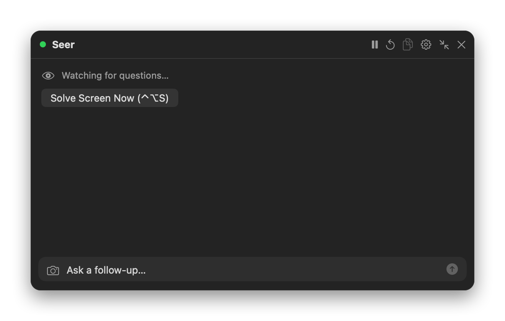

# Seer

A macOS menu bar app that spots questions on your screen and answers them in a small floating overlay.

Created by Arnav Podichetty.

Requires macOS 27 and Apple Silicon.

## Install

1. Download `Seer.dmg` from this repo's **Releases** page, open it and drag **Seer** into **Applications**.
2. Open Seer. The first time, macOS may say it can't verify the developer: go to System Settings → Privacy & Security and click **Open Anyway**. Seer lives in the menu bar, not the Dock.
3. Go to **Settings → API Keys** and paste your free keys:
   - Groq: https://console.groq.com/keys
   - Gemini: https://aistudio.google.com/apikey
4. Grant **Screen & System Audio Recording** in System Settings → Privacy & Security when asked, then reopen Seer.

## Using it

| Shortcut | Action |
| --- | --- |
| ⌃⌥Space | Show or hide the overlay |
| ⌃⌥S | Solve whatever is on screen now |
| ⌃⌥R | Reset the answer |
| ⌃⌥M | Start or pause monitoring |

Shortcuts can be changed in Settings → General. Turn on **Watch screen for questions** to have Seer detect questions automatically, or just use ⌃⌥S when you need it. Esc or ⌘W closes the overlay, and the chat bar at the bottom takes follow-up questions.

## Options

- **Context:** add anything you want Seer to know about you in Settings → Context. It's used for the chat and for personal questions like "Tell me about yourself".
- **Custom model:** if you pay for another model, add it under Settings → API Keys → Custom model. Any OpenAI-compatible API works, such as OpenAI, OpenRouter or DeepSeek. It's tried first, with Groq and Gemini as backups.
- **Offline fallback:** install [Ollama](https://ollama.com) and run `ollama pull qwen3:4b-instruct` and `ollama pull qwen3-vl:4b-instruct`.

## Privacy

- Seer only reads the screen while monitoring is on or when you press Solve. Screenshots stay in memory and are never saved.
- Only the question text, plus a cropped image for picture questions, is sent to the AI provider that answers.
- API keys are stored in the macOS Keychain.
- Seer skips password managers, private browser windows and password fields. You can exclude more apps and windows in Settings → Privacy.
- The overlay shows up in screenshots and screen recordings like any normal window.
